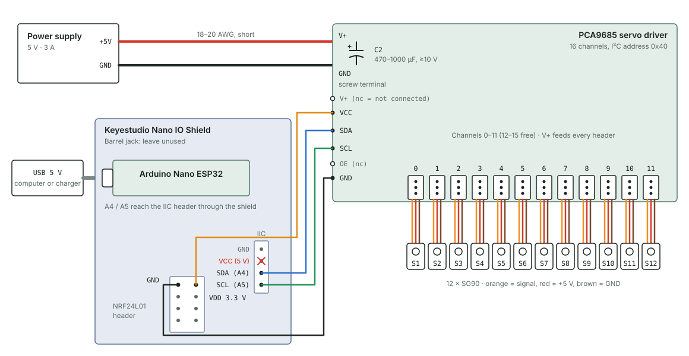
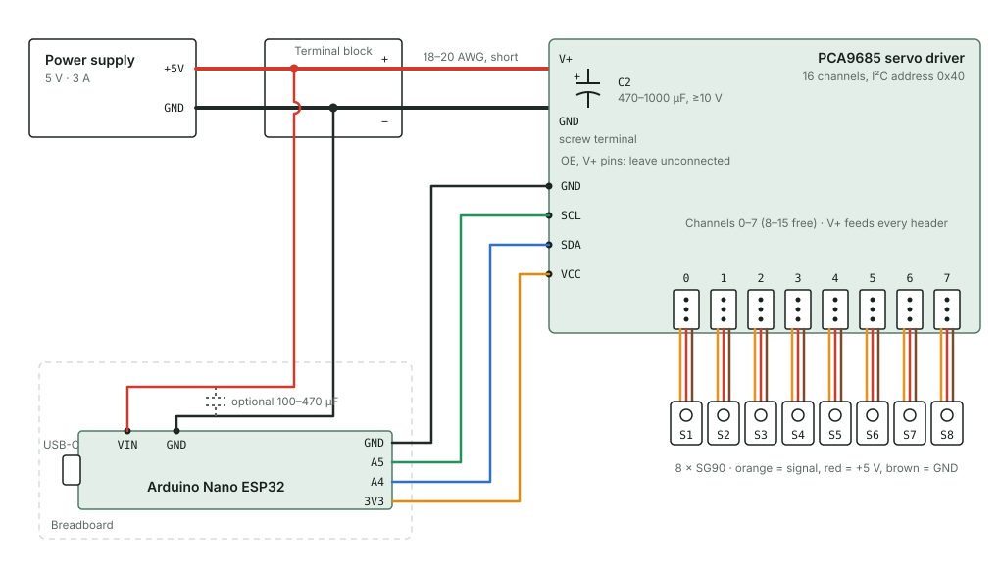

# Halloween Pumpkin Eyes

Plastic eyeballs that look around on their own from inside a carved pumpkin. Each eyeball sits in a swivel socket and is moved by a small SG90 servo. An Arduino Nano ESP32 drives 8 eyes through a PCA9685 servo driver (it can handle up to 16). Every 1.5 seconds, three random eyes each look in a new random direction.

> **Credit:** This build is based on an idea from the YouTube video [Pumpkin Routines DEMO - Pumpkin with moving eyes update](https://www.youtube.com/watch?v=qQNtnuWvH2k) by **Two Boys and a Camera**. This repo documents my own take on the electronics and code.

## Demo

Click a thumbnail to watch the video on YouTube.

| A single pair of eyes | 12 eyes in a pumpkin |
|---|---|
| <a href="https://www.youtube.com/watch?v=rMcllJ7E94A"></a> | <a href="https://www.youtube.com/watch?v=TWEZGnq-aPU"></a> |

## How it works

- The **Nano ESP32** runs the sketch and talks to the PCA9685 over two I²C wires.
- The **PCA9685** generates the control signal for each servo, so one board handles all the eyes (up to 16).
- A **5 V supply** powers the servos through the PCA9685's screw terminal. The Nano gets its own power from USB, so servo current surges can't reset it.

When powered on, every eye moves in turn to one end of its range, then the other, then the centre. After that, the sketch keeps picking three different random eyes and moving each one to its own new position, at least 40° away from where it was.

## Parts

| Qty | Part | Notes |
|---|---|---|
| 1 | Arduino Nano ESP32 | Any ESP32 board works with pin changes. See [Breadboard option](#option-b-breadboard). |
| 1 | Keyestudio Nano IO Shield v1.0 (KS0146) | Optional. Makes wiring easier. |
| 1 | PCA9685 16-channel servo driver | Adafruit #815 or a clone. |
| 8 | SG90 micro servos | One per eye. Any number from 1 to 16 works. |
| 8 | Plastic eyeballs | |
| 8 | 3D-printed eye sockets | [`hardware/eye-socket.stl`](hardware/eye-socket.stl). See [Eye socket](#eye-socket). |
| 1 | 5 V 3 A power supply | Barrel or bare-wire output. 3 A covers three SG90s moving at once, with some margin. |
| 1 | 470–1000 µF electrolytic capacitor, 10 V or higher | Smooths servo current spikes. |
| 1 | USB-C cable and USB charger | Powers the Nano. |
| 4 | Female-to-female jumper wires | Nano/shield to PCA9685. |
| | 18–20 AWG wire | Supply to PCA9685 screw terminal. |
| | Servo extension cables | If the eyes are far from the PCA9685. |
| 1 | Pumpkin | A foam craft pumpkin lasts longer and stays dry. See [Step 6](#step-6-install-in-the-pumpkin). |

### Eye socket

The eye socket is a simple ring that each eyeball sits in. Print one per eye from [`hardware/eye-socket.stl`](hardware/eye-socket.stl).

| Dimension | Inches | mm |
|---|---|---|
| Inside diameter | 1.6 in | 40.6 mm |
| Outside diameter | 1.9 in | 48.3 mm |
| Height | 1.0 in | 25.4 mm |

The STL file is in millimetres. If your slicer shows the part about 25 times too large, it's reading the file as inches.

## Step 1: Install the software

1. Install the [Arduino IDE](https://www.arduino.cc/en/software).
2. Open **Tools → Board → Boards Manager**, search for **Arduino ESP32 Boards** and install it. This is the package that includes the Nano ESP32.
3. Open **Tools → Manage Libraries**, search for **Adafruit PWM Servo Driver Library** and install it. Accept any dependencies it asks for, such as Adafruit BusIO.
4. Select **Tools → Board → Arduino ESP32 Boards → Arduino Nano ESP32**.

## Step 2: Prepare the PCA9685

1. Solder the capacitor into the empty footprint marked **C2** next to the screw terminal. It's polarised: the longer leg (+) goes to V+, and the striped side goes to GND. If your board has no C2 footprint, clamp the capacitor's legs in the screw terminal together with the supply wires.
2. Use the 6-pin header on one short edge of the board for the connections in Step 3. The bare holes on the opposite edge carry the same signals and are only for chaining a second board.

## Step 3: Wire it up

Pick one option. In both, **the PCA9685's VCC must get 3.3 V, never 5 V.** The ESP32's pins aren't 5 V tolerant, and VCC sets the voltage on the I²C lines.

### Option A: Keyestudio Nano IO Shield



The shield doesn't expose the Nano's 3V3 pin. Its NRF24L01 header does provide 3.3 V, so use that. Check with a multimeter first: the header's VDD pin should read about 3.3 V.

| From | To | Notes |
|---|---|---|
| 5 V supply + | PCA9685 screw terminal **V+** | 18–20 AWG, keep it short |
| 5 V supply − | PCA9685 screw terminal **GND** | 18–20 AWG |
| USB charger or computer | Nano **USB-C** | Powers the Nano |
| Shield NRF header **VDD** | PCA9685 **VCC** | 3.3 V |
| Shield NRF header **GND** | PCA9685 **GND** | Required. The only ground link between the Nano and the servo supply. |
| Shield IIC header **SDA** | PCA9685 **SDA** | Nano A4 |
| Shield IIC header **SCL** | PCA9685 **SCL** | Nano A5 |
| Servos 1–8 | PCA9685 channels **0–7** | Brown wire on the GND row |

Leave these unconnected:
- The shield's **barrel jack**. It's built for 7–12 V, and the Nano ESP32 needs no extra power from it.
- The shield's IIC header **VCC**. It's 5 V.
- The PCA9685 header's **V+** and **OE** pins.

### Option B: Breadboard



Here one 5 V supply powers both the servos and the Nano, through a terminal block. Run separate wires from the terminal block to the PCA9685 and to the Nano. Don't route servo current through the breadboard: its rails handle only about 1 A.

| From | To | Notes |
|---|---|---|
| 5 V supply +/− | Terminal block +/− | |
| Terminal block +/− | PCA9685 screw terminal **V+/GND** | 18–20 AWG |
| Terminal block +/− | Nano **VIN/GND** | Jumpers. Never connect the supply to **VBUS**. |
| Nano **3V3** | PCA9685 **VCC** | |
| Nano **GND** | PCA9685 **GND** | |
| Nano **A4** | PCA9685 **SDA** | |
| Nano **A5** | PCA9685 **SCL** | |
| Servos 1–8 | PCA9685 channels **0–7** | |

Arduino's documentation gives VIN a range starting at 5 V, which is the very bottom. If the Nano resets when servos move, add a 100–470 µF capacitor across VIN and GND, or power the Nano from USB instead.

On a different ESP32 board the wiring is the same. Use the pins labelled SDA, SCL and 3V3, and the board's 5 V input. On many ESP32 dev boards, SDA is GPIO21 and SCL is GPIO22.

## Step 4: Upload and test on the bench

Do this before attaching any eyeballs, so a wrong setting can't strain the sockets.

1. Open `firmware/PumpkinEyes/PumpkinEyes.ino` in the Arduino IDE.
2. Edit `SERVO_CHANNELS` to list only the channels that have servos, for example `{0, 1}` for two eyes.
3. Connect the Nano by USB and click **Upload**.
4. Turn on the 5 V supply. Each servo should move in turn to 0°, then 150°, then 75°, with a 5 second pause after each step. Then the random movement starts.

## Step 5: Attach the eyeballs

<!-- TODO: describe how the servo connects to the eyeball (horn, wire link, glue) and add photos -->

1. With the servos centred (the sketch ends its start sequence at the midpoint), fit each servo horn so that the eye looks straight ahead.
2. Find how far each eye can swivel before the socket or linkage stops it. Set `MIN_ANGLE` and `MAX_ANGLE` inside that range, with a few degrees of margin. A servo pushing against a hard stop buzzes, heats up and draws extra current.
3. If the range is small, reduce `MIN_CHANGE` too. It must stay well below `MAX_ANGLE − MIN_ANGLE`.

## Step 6: Install in the pumpkin

<!-- TODO: add carving notes and photos -->

1. Cut holes for the eye sockets. Size each hole so the socket fits snugly.
2. Mount the servos behind the sockets so the linkage moves freely.
3. Keep the Nano, shield, PCA9685 and power supply **outside** the pumpkin, or in a sealed box or bag. A real pumpkin is wet inside and gets wetter as it rots. Run servo extension cables through a small hole in the back.
4. Don't put a candle in a pumpkin with electronics in it. Use a battery LED light if you want a glow.
5. A foam craft pumpkin avoids the moisture problem and can be reused next year.

## Settings

All settings are constants at the top of `PumpkinEyes.ino`.

| Setting | Default | What it does |
|---|---|---|
| `SERVO_CHANNELS` | `{0, 1, ..., 7}` | PCA9685 channels with an eye attached |
| `MIN_ANGLE` / `MAX_ANGLE` | `0` / `150` | Range each eye moves within |
| `MIN_CHANGE` | `40` | Minimum degrees between an eye's positions |
| `EYES_PER_MOVE` | `3` | How many different eyes move together |
| `HOLD_MS` | `1500` | Pause between each group of random moves |
| `START_HOLD_MS` | `5000` | Pause after each step of the start sequence |
| `STAGGER_MS` | `600` | Gap between eyes during the start sequence |
| `SERVO_MIN_US` / `SERVO_MAX_US` | `500` / `2400` | Pulse widths for 0° and 180° |

## Troubleshooting

| Problem | Things to check |
|---|---|
| No servos move | Is the 5 V supply on? Is the PCA9685's GND connected to the Nano's GND? Does VCC read 3.3 V? Are SDA and SCL swapped? |
| Nano restarts when servos move | Power the Nano from USB, separately from the servos. Check that the C2 capacitor is fitted. |
| A servo buzzes or strains at one end | Narrow `MIN_ANGLE`/`MAX_ANGLE` to stay inside the socket's range. If it buzzes even with no eyeball, narrow `SERVO_MIN_US`/`SERVO_MAX_US`. |
| One servo doesn't move | Check its plug orientation (brown to GND) and that its channel is listed in `SERVO_CHANNELS`. |
| Eyes move too often or too rarely | Change `HOLD_MS`, or `EYES_PER_MOVE`. |
| Nano restarts or servos twitch when a group moves | Lower `EYES_PER_MOVE`, or use a supply with more current. |

## Repository layout

```
firmware/PumpkinEyes/PumpkinEyes.ino   Arduino sketch
docs/wiring-shield.svg                 Wiring diagram, Keyestudio shield option
docs/wiring-breadboard.svg             Wiring diagram, breadboard option
hardware/eye-socket.stl                3D-printable eye socket (mm)
LICENSE                                MIT license
```

## License

[MIT](LICENSE)
